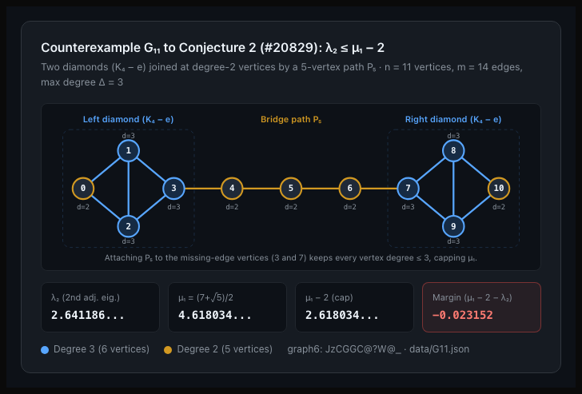

# Disproof of Spectral Graph Conjecture #20829 ($\lambda_2 \le \mu_1 - 2$)

This repository contains a counterexample, a machine-checked Lean 4 proof, and an exact asymptotic construction refuting Conjecture 2 (#20829) from Tristan Cazenave, *Lemmas and Conjectures in Spectral Graph Theory* ([arXiv:2611.03879v1](https://arxiv.org/abs/2611.03879), November 2, 2026).



## Conjecture statement

Let $G$ be a simple, undirected, connected graph on $n \ge 2$ vertices. Let $\lambda_1 \ge \lambda_2 \ge \dots \ge \lambda_n$ be the eigenvalues of the adjacency matrix $A(G)$, and let $\mu_1 \ge \mu_2 \ge \dots \ge \mu_n = 0$ be the eigenvalues of the Laplacian matrix $\mathcal{L}(G) = D(G) - A(G)$.

Conjecture 2 (#20829) in Section 7 of `arXiv:2611.03879v1` (listed as `ouverte` on line 1729 of `index_conjectures.csv` in `preuves_spectrales.zip`) asks whether every connected graph satisfies

$$\lambda_2(A(G)) \le \mu_1(\mathcal{L}(G)) - 2.$$

## Main results

### Theorem 1 (11-vertex counterexample, formalized in Lean 4)

Let $G_{11}$ be the 11-vertex, 14-edge connected graph obtained by joining two diamonds ($K_4 - e$) at degree-2 vertices via a 5-vertex path $P_5$ (`graph6`: `JzCGGC@?W@_`). Then

$$\lambda_2(A(G_{11})) > \frac{3 + \sqrt{5}}{2} = \mu_1(\mathcal{L}(G_{11})) - 2.$$

Specifically,

- $\chi_A(x) = x(x+1)^2(x+2)(x^3 - 3x^2 - x + 5)(x^4 - x^3 - 5x^2 + x + 2)$,
- $\chi_{\mathcal{L}}(x) = x(x-4)^2(x^2 - 7x + 11)(x^2 - 4x + 2)(x^4 - 9x^3 + 25x^2 - 22x + 2)$,
- $\lambda_1(G_{11}) \approx 2.67513087056665$ (largest root of $x^3 - 3x^2 - x + 5$),
- $\lambda_2(G_{11}) \approx 2.64118647619329$ (largest root of $x^4 - x^3 - 5x^2 + x + 2$),
- $\mu_1(G_{11}) = \frac{7 + \sqrt{5}}{2} \approx 4.61803398874989$ (largest root of $x^2 - 7x + 11$),
- $\mu_1(G_{11}) - 2 - \lambda_2(G_{11}) \approx -0.023152487443397 < 0$.

**Short proof.** Set $\alpha = \frac{3 + \sqrt{5}}{2} = \mu_1(G_{11}) - 2$. At $x = \alpha$, the two monic factors of $\chi_A(x)$ evaluate to $\alpha^3 - 3\alpha^2 - \alpha + 5 = 2 - \sqrt{5} < 0$ and $\alpha^4 - \alpha^3 - 5\alpha^2 + \alpha + 2 = \frac{1 - \sqrt{5}}{2} < 0$. Because both factors are monic, each has a real root strictly greater than $\alpha$, so $A(G_{11})$ has at least two eigenvalues strictly greater than $\mu_1(G_{11}) - 2$.

**Formalization.** [`Disproof20829/G11.lean`](Disproof20829/G11.lean) proves `disprove_conjecture_20829` in Lean 4 (`v4.37.0-rc1`) and Mathlib using the exact `SimpleGraph (Fin 11)`, `adjMatrix ℝ`, `lapMatrix ℝ`, and `eigenvalues₀` definitions of Cazenave's `SpectralLean/Invariants.lean`. The proof bounds $\lambda_2(G_{11}) > 21/8$ by Courant-Fischer on two orthogonal, $A$-orthogonal integer vectors and bounds $\mu_1(G_{11}) < 37/8$ by an explicit 11-term block-diagonal sum-of-squares identity. `#print axioms Disproof20829.disprove_conjecture_20829` depends only on `[propext, Classical.choice, Quot.sound]`.

**Note on minimality.** `arXiv:2611.03879v1` checked Conjecture 2 exhaustively for all connected graphs with $n \le 9$. We did not check all 11.7 million connected 10-vertex graphs exhaustively (simulated annealing on $n = 10$ stopped at margin $+0.037408$), so we do not claim that $n = 11$ is the minimum counterexample order.

### Theorem 2 (Sharp infimum $\inf_{G \text{ connected}} (\mu_1(G) - \lambda_2(G)) = 1$)

For every connected simple graph $G$ on $n \ge 2$ vertices, Grone and Merris proved $\mu_1(G) \ge \Delta(G) + 1$, while Perron-Frobenius gives $\lambda_2(G) < \lambda_1(G) \le \Delta(G)$. Hence $\mu_1(G) - \lambda_2(G) > 1$ strictly for every connected graph, so the infimum $1$ is never attained.

To show that $1$ cannot be improved, fix an integer $s \ge 4$, set $k = s^2 + 1$ and $r = s$, and construct $G(k, r)$ on $2k = 2s^2 + 2$ vertices as follows. Take two disjoint copies of $K_k$, delete $r$ edges incident to one chosen vertex $u_i$ in each copy ($i \in \{1, 2\}$), and add the single bridge edge $u_1 u_2$.

In copy $i$, partition the vertices into $\{u_i\}$, the set $N_i$ of $s^2 - s$ neighbors of $u_i$ in copy $i$, and the set $M_i$ of $s$ non-neighbors of $u_i$ in copy $i$. This 6-cell partition $(u_1, N_1, M_1, u_2, N_2, M_2)$ is equitable, and each $N_i$ and $M_i$ is a clique of true twins. The full spectrum therefore consists of two $3 \times 3$ quotient matrices (symmetric and antisymmetric across copies) together with the internal twin eigenvalues:

- for $A(G)$: $-1$ with multiplicity $2(s^2 - s - 1) + 2(s - 1) = 2s^2 - 4$,
- for $\mathcal{L}(G)$: $k$ on $N_i$ with multiplicity $2(s^2 - s - 1)$ and $k - 1$ on $M_i$ with multiplicity $2(s - 1)$.

Courant-Fischer on the orthogonal, $A$-orthogonal vectors $z_+ = \mathbf{1}$ and $z_- = (+1 \text{ on copy } 1,\; -1 \text{ on copy } 2)$ yields

$$\lambda_2(G(s^2 + 1, s)) \ge s^2 - \frac{2s + 1}{s^2 + 1} > s^2 - \frac{3}{s} \qquad (s \ge 1).$$

Exact symbolic polynomial positivity on both $3 \times 3$ Laplacian quotient matrices in [`scripts/prove_symbolic.py`](scripts/prove_symbolic.py) proves $\mu_1(G(s^2 + 1, s)) < s^2 + 1 + \frac{3}{s}$ for every integer $s \ge 4$ (and the internal twin eigenvalues $k, k - 1$ lie strictly below this bound). Therefore

$$\mu_1(G(s^2 + 1, s)) - \lambda_2(G(s^2 + 1, s)) < 1 + \frac{6}{s} \qquad (s \ge 4),$$

which violates Conjecture 2 (#20829) for every $s \ge 7$ (and numerically already at $s = 4$, where $\mu_1 - \lambda_2 \approx 1.855$). Taking $s \to \infty$ gives $\inf_{G \text{ connected}} (\mu_1(G) - \lambda_2(G)) = 1$.

## Graph data

- Graph6: `JzCGGC@?W@_` ([`data/G11.g6`](data/G11.g6))
- Edge list (vertices `0..10`): `(0,1), (0,2), (1,2), (1,3), (2,3), (3,4), (4,5), (5,6), (6,7), (7,8), (7,9), (8,9), (8,10), (9,10)` ([`data/G11.json`](data/G11.json))

## Verification

### Lean 4 proof (Theorem 1)

Requires [elan](https://github.com/leanprover/elan).

```bash
lake exe cache get
lake build Disproof20829
```

Expected output includes:

```text
'Disproof20829.disprove_conjecture_20829' depends on axioms: [propext, Classical.choice, Quot.sound]
```

### Symbolic and high-precision Python proofs (Theorems 1 and 2)

```bash
python3 -m venv .venv
.venv/bin/pip install -r scripts/requirements.txt
.venv/bin/python scripts/prove_symbolic.py
.venv/bin/python scripts/verify_high_precision.py --self-test
.venv/bin/python scripts/verify_high_precision.py data/G11.json
```

## Repository layout

- `Disproof20829/G11.lean`: Lean 4 formal disproof of Conjecture 2 (#20829) via $G_{11}$.
- `scripts/prove_symbolic.py`: Zero-floating-point SymPy proofs of Theorems 1 and 2, including full-matrix characteristic polynomial checks for $s \in \{3, 4, 5\}$.
- `scripts/verify_high_precision.py`: 50-digit `mpmath` verifier with eigenpair residual checks ($\|Mv - \lambda v\|_\infty < 10^{-40}$) and negative-control self-tests.
- `search/search_c2.cpp`: C++ (Apple Accelerate LAPACK) simulated annealing code that discovered $G_{11}$.
- `data/G11.g6`, `data/G11.json`, `data/G11.png`: Counterexample data and figure.

## Disclosure of computational and AI assistance

The counterexample $G_{11}$ was discovered by the C++ simulated annealing script in `search/search_c2.cpp`. The exact symbolic proof, the infinite family $G(s^2 + 1, s)$, and the Lean 4 formalization were developed with AI assistance and audited independently across multiple models. Every mathematical claim in Theorem 1 is checked by the Lean 4 kernel with standard axioms only, and both Theorems 1 and 2 are checked by exact rational arithmetic in `scripts/prove_symbolic.py`.

## References

1. T. Cazenave, *Lemmas and Conjectures in Spectral Graph Theory*, [arXiv:2611.03879v1](https://arxiv.org/abs/2611.03879), November 2026; archive at `https://www.lamsade.dauphine.fr/~cazenave/papers/preuves_spectrales.zip`.
2. R. Grone and R. Merris, *The Laplacian spectrum of a graph II*, SIAM J. Discrete Math. 7 (1994), 221-229.
